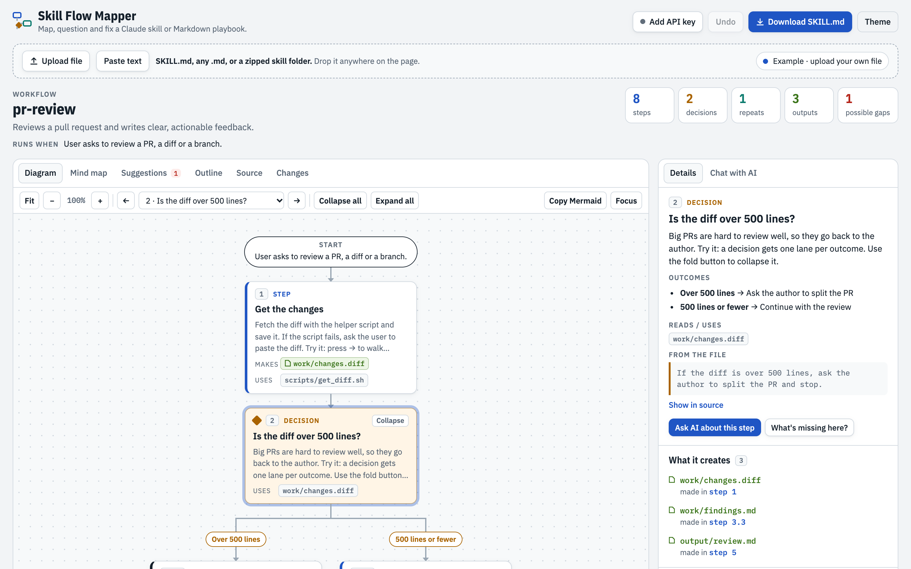

# justools — Skill Flow & Project Flow Mapper

[](https://github.com/m0rath/skill-flow/actions/workflows/ci.yml)

Visual tools for AI agent skills, workflows and software codebases. AI drafts. Humans decide.

- **Skill Flow Mapper** (`/skill-flow`) — upload a `SKILL.md`, Markdown playbook or zipped skill folder. See the workflow as a diagram or mind map, review AI suggestions for gaps, fix the file, and export PNG, SVG, Mermaid or Markdown.
- **Project Flow Mapper** (`/project-flow`) — open a project folder or `.zip`. Inspect its architecture, startup paths, routes and call flows, review suggestions, and export the result.

[](https://justools.in/)

## Try it

[justools.in](https://justools.in/) — no install required.

## Stack

Vite 8 · React 19 · TypeScript 5.9 · React Router 7 · Zustand 5 · `motion` · `jszip` · `html-to-image` · Netlify Functions 2.0 · Netlify Blobs.

The production site is the React app in [`app/`](app/README.md). Netlify builds `app/` and publishes `app/dist/`.

## Run locally

```bash
cd app
npm install
npm run dev
# then open http://localhost:5173
```

The diagram, mind map, quick checks, outline, source editing and downloads work without a key. Chat, AI mapping and the gap review need either the shared demo or your own provider key.

### Demo AI

The default **Try the demo** model is **Gemini 3.5 Flash-Lite**; **Mistral Small 4** is also selectable. Requests go to the same-origin `/api/demo` route, which Netlify rewrites to `app/netlify/functions/demo.mjs`. The provider keys stay server-side and the function enforces per-IP and global limits.

For local demo requests, create `app/.env.local` with:

```bash
DEMO_GEMINI_API_KEY=
DEMO_MISTRAL_API_KEY=
# optional, stable salt for hashing visitor IPs
DEMO_IP_SALT=
```

The demo proxy is served by Vite in development. `npm run preview` does not include the function; use `npm run dev` or `netlify dev` when testing it.

### Bring your own key

Choose Anthropic, OpenAI, Gemini or Mistral in **AI settings** and paste a key. BYO requests go directly from the browser to the selected provider; the key is not sent through this site. The demo shows a short privacy banner because its prompts go to the selected provider and may be used to improve their models.

See [`app/README.md`](app/README.md) for configuration, limits, privacy details and deployment.

## Development

Run these from `app/`:

```bash
npm run dev            # Vite dev server
npm run build          # type-check + production build to app/dist
npm run preview        # serve the production build
npm run check          # typecheck + lint + format check + tests
npm test               # demo proxy tests
npm run lint
npm run format:check
```

CI runs the same app checks and build in [`.github/workflows/ci.yml`](.github/workflows/ci.yml). The Netlify deploy workflow publishes on pushes to `main` and on manual dispatch, after the checks pass.

## Project structure

```
app/                       React + TypeScript SPA (the production app)
  index.html               document shell and social metadata
  public/                  static assets, _headers, _redirects, fonts, favicon
  netlify/functions/       demo.mjs — hidden-key AI proxy and rate limits
  src/                     components, features, stores, AI/model/lib code
  test/                    demo proxy tests
  vite.config.ts           React, CSP and local /api/demo middleware
netlify.toml               Netlify build (base app/, publish app/dist/)
.github/workflows/         CI and Netlify deploy
docs/                      README images
```

## Security

- The demo's provider keys live only in the Netlify Function environment.
- BYO keys stay in the browser and are sent only to the provider the user selects.
- The CSP allowlists the AI providers, GitHub import and Google Analytics. Keep `app/vite.config.ts` and `app/public/_headers` in sync when adding a host.
- Uploaded files and AI output are untrusted. Render them through React or the escaping helpers; never evaluate them.

See [`SECURITY.md`](SECURITY.md) for the reporting process.

## License

[MIT](LICENSE). Bundled third-party assets keep their own licenses:

- JSZip: MIT or GPLv3
- html-to-image: MIT
- IBM Plex fonts: SIL Open Font License 1.1 (`app/public/assets/fonts/OFL.txt`)

See [CONTRIBUTING.md](CONTRIBUTING.md), [SECURITY.md](SECURITY.md), [CODE_OF_CONDUCT.md](CODE_OF_CONDUCT.md) and [CHANGELOG.md](CHANGELOG.md).
